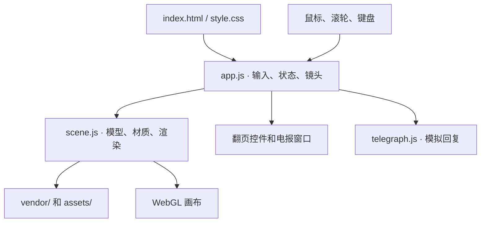

# 行军案头

长征主题的交互式 3D 书桌。项目用原生 HTML、CSS、JavaScript 和 Three.js 搭建。浏览器加载本地模型代码与贴图，在同一个场景里完成全景、坐姿和道具特写之间的切换。

## 文件怎么找

```text
ocup_web/
├─ example/                        参考作品的网页代码快照
│  ├─ 01-Interactive-Desk/          主要参考，镜头推进与文稿换页
│  └─ 请先阅读.md                   参考文件的来源和收录范围
├─ march-desk/                     行军案头项目，独立 Git 仓库
│  ├─ README.md                    本说明
│  ├─ dist/                        当前源码和静态预览目录
│  │  ├─ index.html                页面入口、画布、翻页控件、电报窗口
│  │  ├─ style.css                 页面布局、暗角与窄屏样式
│  │  ├─ app.js                    输入、镜头、交互状态、文稿和日记文案
│  │  ├─ scene.js                  3D 模型、材质、光照、贴图和描边
│  │  ├─ telegraph.js              电报回复接口与本地模拟回执
│  │  ├─ assets/
│  │  │  └─ route-map.webp           从概念图提取的地图贴图
│  │  └─ vendor/                    本地 Three.js、几何工具、后处理和许可证
│  └─ .openai/hosting.json          上一轮 Sites 私有版本的托管配置
└─ output/
   ├─ imagegen/                    场景概念图与设计迭代图
   └─ march-desk-site.tar.gz        早期私有版本的打包归档
```

当前改动直接编辑 `march-desk/dist/` 中的文件。虽然目录名是 `dist`，在这个项目里它同时存放源码和浏览器实际加载的文件。查看最新效果时以该目录为准。运行网页只需要它，参考工程和设计素材单独存放。

## 程序如何运行



1. `index.html` 提供画布和交互控件，通过 ES 模块加载 `app.js`。页面的导入映射把 Three.js 指到项目里的本地文件。
2. `app.js` 调用 `scene.js` 的 `createScene()` 建立场景。桌椅、油灯、日记本和电报机由 JavaScript 中的几何体组合建模。书脊使用挤出的弧形截面，书页文字和木纹由 Canvas 生成，墙上的长征地图使用 WebP 贴图。
3. `app.js` 监听鼠标、点击、滚轮和键盘。点击时从镜头向鼠标位置发射射线，命中道具后切换视图或切换灯光。主渲染循环按帧更新镜头、道具动画和灯光，再由 `scene.js` 绘制。
4. 首页滚轮在斜上方与桌前坐姿之间连续插值，鼠标移动叠加小幅视差。道具特写通过曲线过渡到预设位置。返回全景时恢复进入特写前的滚轮视角。

## 常见改动入口

| 要改什么 | 主要位置 |
| --- | --- |
| 书桌、椅子、道具位置或材质 | `scene.js` 的 `furniture()`、`makeLamp()`、`makeRadio()` 和 `createScene()` |
| 日记本书脊、书封、纸页几何 | `scene.js` 的 `makeSpine()` 和 `createScene()` 中的日记本模型 |
| 全景、坐姿、日记本俯视角度 | `app.js` 的 `cameraPose()`、`moveOverview()` 和滚轮事件 |
| 镜头转场和返回 | `app.js` 的 `flightTo()`、`select()` 和 `frame()` |
| 文稿、日记的文字与换页 | `app.js` 顶部的 `papers`、`diary`，以及 `flip()` 和 `animatePaper()`。书页排版在 `scene.js` 的 `printPage()` |
| 悬停描边 | `scene.js` 的 `render()`。纸张用原有发光边缘，油灯、日记本和电报机用纯轮廓线，地图用贴合模型四边的细线 |
| 长征地图画面 | `assets/route-map.webp`。地图聚焦和环境暗化由 `app.js` 控制 |
| 电报窗口、发报和收报动画 | `index.html`、`style.css`、`app.js` 中的电报表单及收发状态 |
| 后续接入 AI 回复 | `telegraph.js` 的 `requestReply(message, { signal })`。当前返回本地模拟回执，后续可改为调用服务端接口，由服务端保管密钥 |

## 本地预览

在 PowerShell 中运行下面的命令，再用支持 WebGL 2 的浏览器打开 [本地预览](http://127.0.0.1:8765/)。

```powershell
Set-Location 'D:/ecode/ocup_web/march-desk'
python -m http.server 8765 --bind 127.0.0.1 --directory dist
```

如果预览已经打开，刷新即可读取最新文件。页面使用 ES 模块，从本地 HTTP 地址访问可以正常加载模块和贴图。修改 Three.js 相关效果时，优先调整 `scene.js` 中调用后处理的逻辑，`vendor/` 作为第三方依赖使用。
